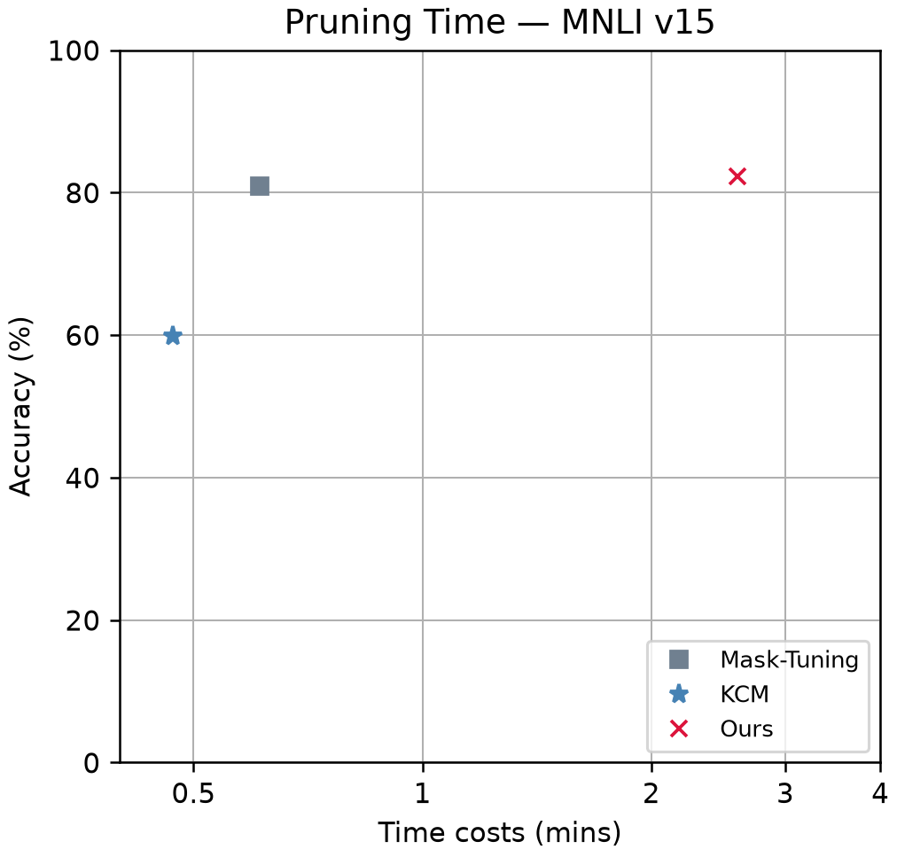
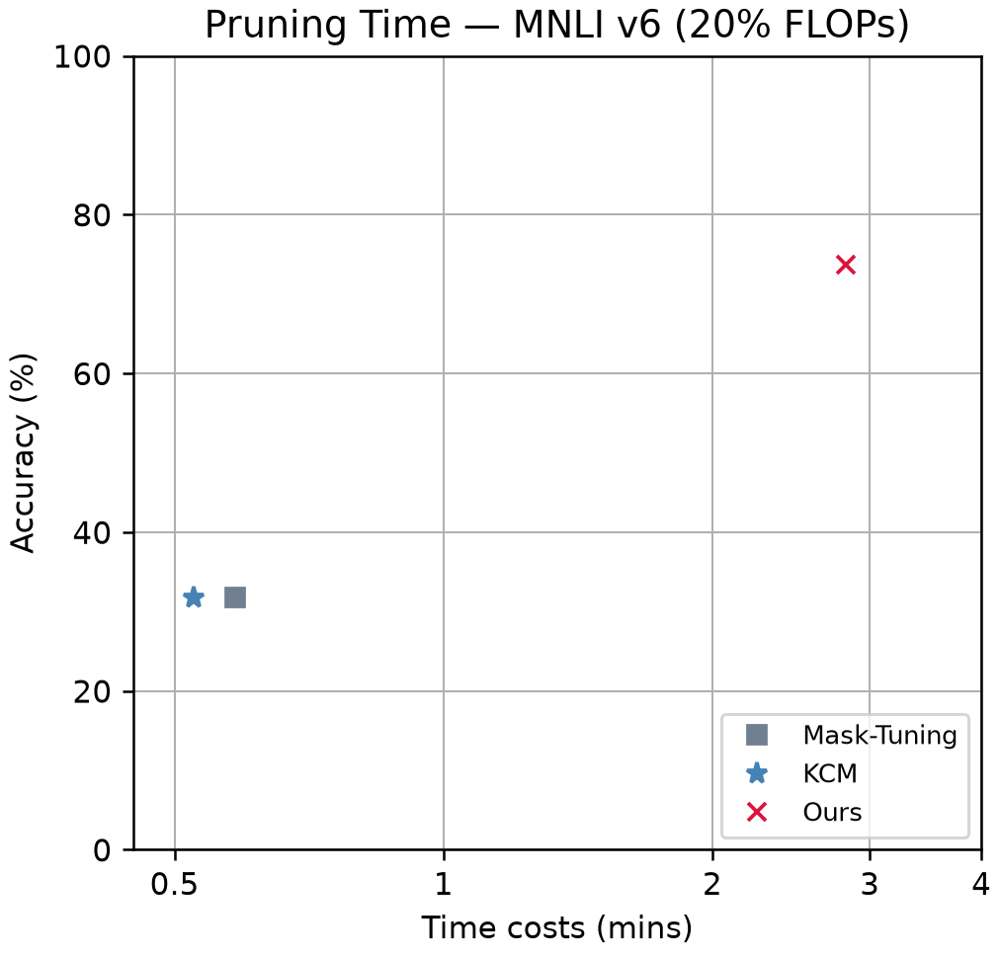
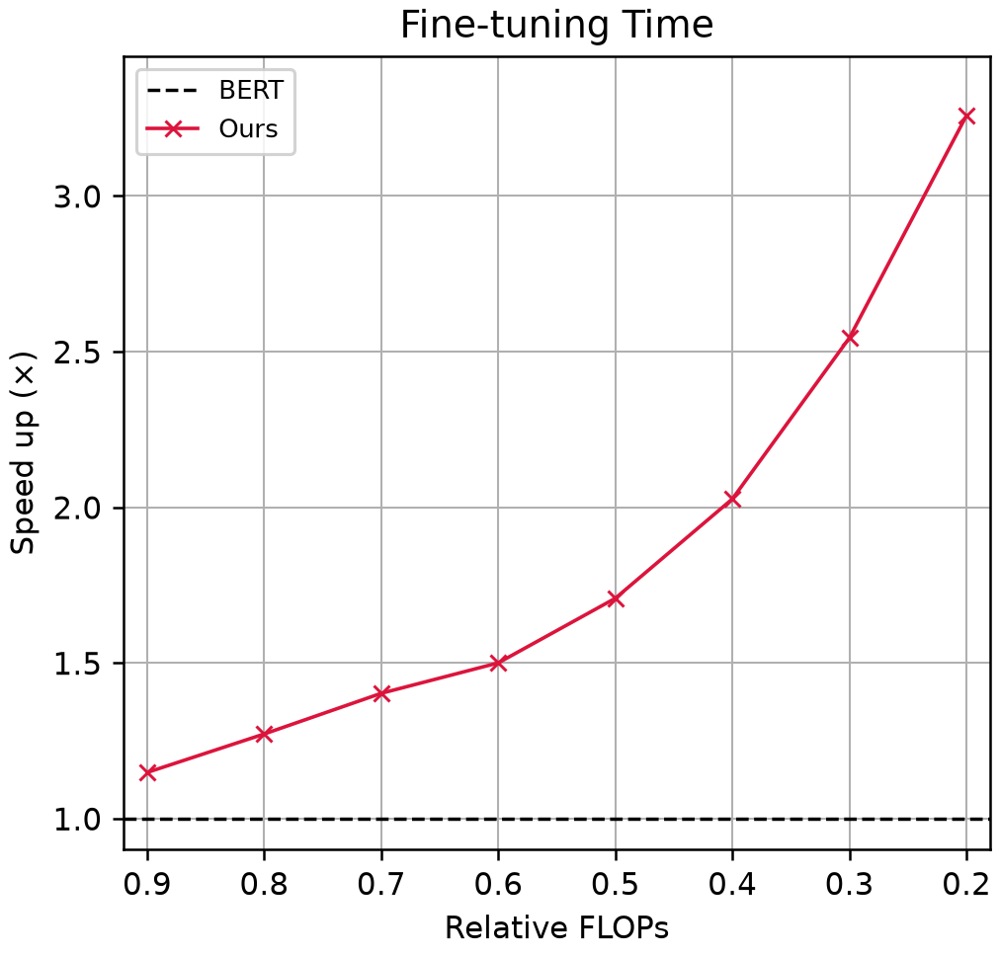

# P-pruning

Mã nguồn chính thức cho bài báo tại LREC-COLING 2024, “Pruning before Fine-tuning: A Retraining-free Compression Framework for Pre-trained Language Models” ([bài báo](https://aclanthology.org/2024.lrec-main.1162/)).

<div align="center">
  
</div>

## Cấu hình fine-tuning

| Mô hình | Tác vụ | Learning rate | Batch size | Epoch |
|:--:|:--|:--:|:--:|:--:|
| BERT | `stsb`, `mrpc`, `sst2`, `qnli`, `qqp`, `mnli`, `squad`, `squad_v2` | 5e-5, 3e-5, 2e-5 | 16, 32 | 2, 3, 4 |
| GPT-2 | `penn_treebank` | 1e-4 | 32 | 10 |
| GPT-2 | `wikitext-2-v1` | 5e-4 | 32 | 8 |
| GPT-2 | `wikitext-103-v1` | 1e-4 | 32 | 10 |

## Tái thực nghiệm Table 2 trên một số tác vụ

Chúng tôi trình bày kết quả tái thực nghiệm Table 2 trên MRPC, SST-2 và QNLI, với bốn điều kiện BERT-base cho mỗi tác vụ. Mỗi ô ghi điểm trong bài báo → điểm chạy lại, kèm chênh lệch theo điểm phần trăm (chạy lại trừ bài báo). [Table 2 của bài báo](https://aclanthology.org/2024.lrec-main.1162.pdf#page=8)

| Tác vụ (thước đo) | BERTBASE | Random | +MC | +CS |
|:--|--:|--:|--:|--:|
| MRPC (accuracy) | 86.27 → 85.78 (−0.49) † | 77.45 → 76.96 (−0.49) | 81.86 → 81.13 (−0.73) | 86.03 → 85.78 (−0.25) † |
| SST-2 (accuracy) | 93.12 → 93.12 (0.00) ‡ | 90.83 → 91.40 (+0.57) | 91.74 → 92.43 (+0.69) | 92.32 → 91.40 (−0.92) |
| QNLI (accuracy) | 91.41 → 91.32 (−0.09) | 88.49 → 85.56 (−2.93) § | 89.75 → 88.76 (−0.99) | 89.22 → 88.63 (−0.59) |

† Hai ô `BERTBASE` và `+CS` trên MRPC dùng v31 với LR `5e-5` và 4 epoch. Cả hai đạt 85.78% accuracy, trong đó `+CS` giữ 59.14% FLOPs. [Báo cáo MRPC v31](experiments/table2_selected_tasks/mrpc_v31_run_report.json) · [Lần chạy trên Kaggle](https://www.kaggle.com/code/cymeu4l0t/p-pruning-table-2-squad-cs?scriptVersionId=372443516)

‡ Ô `BERTBASE` trên SST-2 dùng v33 với LR `5e-5` và 4 epoch. Accuracy khớp với bài báo khi làm tròn đến hai chữ số thập phân. [Báo cáo SST-2 v33](experiments/table2_selected_tasks/sst2_v33_run_report.json) · [Lần chạy trên Kaggle](https://www.kaggle.com/code/cymeu4l0t/p-pruning-table-2-squad-cs?scriptVersionId=372450081)

§ Ô `Random` trên QNLI dùng kết quả mới nhất v38 với LR `8e-5` và 4 epoch, giữ 59.57% FLOPs. Lần v37 với LR `5e-5` và 4 epoch đạt 87.19% accuracy. [Báo cáo QNLI v38](experiments/table2_selected_tasks/qnli_v38_run_report.json) · [Lần chạy v38 trên Kaggle](https://www.kaggle.com/code/cymeu4l0t/p-pruning-table-2-squad-cs?scriptVersionId=372527132) · [Lần chạy v37 trên Kaggle](https://www.kaggle.com/code/cymeu4l0t/p-pruning-table-2-squad-cs?scriptVersionId=372506462)

Bảng dưới ghi mức cải thiện so với cắt tỉa ngẫu nhiên trong cùng lần chạy. MRPC dùng lần chạy ban đầu và QNLI dùng v8, đều với LR `2e-5` và 3 epoch.

| Tác vụ | Bài báo +MC | Tái thực nghiệm +MC | Bài báo +CS | Tái thực nghiệm +CS |
|:--|--:|--:|--:|--:|
| MRPC | +4.41 | +4.17 | +8.58 | +5.64 |
| SST-2 | +0.91 | +1.03 | +1.49 | 0.00 |
| QNLI | +1.26 | +1.98 | +0.73 | +1.85 |

Trong QNLI v8, ba cấu hình cắt tỉa đều giữ 59.57% FLOPs. Thứ tự BERTBASE > +MC > +CS > Random khớp với bài báo. `+MC` và `+CS` chỉ chênh 0.13 điểm phần trăm ở seed 3407. Mức cải thiện +0.73 của `+CS` trong bài báo được tính từ hai điểm công bố (89.22 − 88.49). Bảng gốc in +0.77.

**Thiết lập chung** gồm `bert-base-uncased`, seed 3407, 3.000 mẫu hiệu chuẩn, 200 token lấy mẫu, λ=5, δ=0.001 và mục tiêu giữ 60% FLOPs. Fine-tuning mặc định dùng LR `2e-5`, 3 epoch và batch size 32 mỗi GPU. Độ dài chuỗi tối đa là 128 cho MRPC và QNLI, và 64 cho SST-2. Các lần chạy dùng Tesla T4. BERTBASE là mô hình BERT nguyên vẹn sau fine-tuning.

Lần chạy QNLI v8 hoàn tất cả bốn cấu hình, mỗi cấu hình 3 epoch, trong 3 giờ 28 phút 52 giây trên Tesla T4. Bộ nhớ GPU đạt đỉnh 4.605 MiB.

Báo cáo gốc gồm [lần chạy ban đầu có MRPC và SST-2](experiments/table2_selected_tasks/initial_run_report.json) và [lần chạy QNLI v8](experiments/table2_selected_tasks/qnli_run_report.json).

## Thực nghiệm Figure 4: thời gian pruning trên MNLI

### Thời gian pruning ở mức 60% FLOPs



Biểu đồ thể hiện accuracy trên MNLI matched theo thời gian pruning (thang log) ở mức khoảng 60% FLOPs. Lần chạy full v15 dùng Tesla T4, seed `3407`, learning rate `2e-5` và 3 epoch. [Kết quả MNLI v15 trên Kaggle](https://www.kaggle.com/code/cymeu4l0t/p-pruning-figure-4-mnli?scriptVersionId=372172179)

| Phương pháp | Accuracy MNLI matched | FLOPs giữ lại | Pruning (phút) | Fine-tuning (phút) | Tổng (phút) |
|:--|--:|--:|--:|--:|--:|
| BERT | 84,53% | 100,00% | 0,00 | 239,56 | 239,56 |
| Ours | 82,26% | 59,62% | 2,60 | 159,66 | 162,26 |
| KCM | 59,91% | 60,00% | 0,47 | 239,56* | 240,03 |
| Mask-Tuning | 80,95% | 60,00% | 0,61 | 239,56* | 240,17 |

\* KCM và Mask-Tuning dùng chung checkpoint BERT. Tổng thời gian của mỗi phương pháp gồm thời gian fine-tuning BERT và thời gian pruning của phương pháp đó.

### Thời gian pruning ở mức 20% FLOPs



Lần chạy full v6 dùng `bert-base-uncased` trên Tesla T4, seed `3407`, learning rate `2e-5`, batch size 32 và 3 epoch. Biểu đồ đặt accuracy MNLI matched theo thời gian pruning trên trục log. [Kết quả MNLI v6 trên Kaggle](https://www.kaggle.com/code/lctrnnguynkhi/tnkl-p-pruning-figure4-0-2-flops?scriptVersionId=372998334)

| Phương pháp | Accuracy MNLI matched | FLOPs giữ lại | Pruning (phút) | Fine-tuning (phút) | Tổng (phút) |
|:--|--:|--:|--:|--:|--:|
| BERT | 84,55% | 100,000% | 0,00 | 250,45 | 250,45 |
| Ours | 73,76% | 19,793% | 2,82 | 73,65 | 76,47 |
| KCM | 31,82% | 19,999% | 0,52 | 250,45* | 250,97 |
| Mask-Tuning | 31,82% | 19,998% | 0,58 | 250,45* | 251,03 |

\* Hai phương pháp dùng chung checkpoint BERT dense. Tổng của mỗi dòng tính cả thời gian fine-tuning BERT và thời gian pruning của phương pháp đó.

KCM ở mức 20% dùng bản mở rộng xếp hạng và cắt thêm attention head để đạt ngân sách FLOPs. Phiên chạy hoàn tất với cảnh báo tràn số từ SciPy LSMR trong bước Mask-Tuning. Ảnh hưởng của cảnh báo lên accuracy chưa được xác định.

### Thời gian fine-tuning theo FLOPs giữ lại



Biểu đồ dùng các mức FLOPs mục tiêu trên trục ngang. Hệ số tăng tốc bằng thời gian fine-tuning BERT v15 chia cho thời gian fine-tuning Ours tại từng mức. Cả ba phiên đều chạy full MNLI trên Tesla T4. Bảng ghi thêm FLOPs thực tế và accuracy của từng điểm. [Kaggle v15](https://www.kaggle.com/code/cymeu4l0t/p-pruning-figure-4-mnli?scriptVersionId=372172179) · [Kaggle v16](https://www.kaggle.com/code/cymeu4l0t/p-pruning-figure-4-mnli?scriptVersionId=372621297) · [Kaggle v17](https://www.kaggle.com/code/cymeu4l0t/p-pruning-figure-4-mnli?scriptVersionId=372621541)

| Phương pháp | FLOPs mục tiêu | FLOPs giữ lại | Accuracy MNLI matched | Fine-tuning (phút) | Tăng tốc so với BERT | Phiên |
|:--|--:|--:|--:|--:|--:|:--|
| BERT | 100% | 100,00% | 84,53% | 239,56 | 1,00× | v15 |
| Ours | 90% | 89,64% | 83,72% | 208,57 | 1,15× | v16 |
| Ours | 80% | 79,62% | 83,31% | 188,32 | 1,27× | v16 |
| Ours | 70% | 69,63% | 82,89% | 170,78 | 1,40× | v16 |
| Ours | 60% | 59,62% | 82,26% | 159,66 | 1,50× | v15 |
| Ours | 50% | 49,71% | 81,42% | 140,26 | 1,71× | v17 |
| Ours | 40% | 39,78% | 80,32% | 118,18 | 2,03× | v17 |
| Ours | 30% | 29,36% | 77,86% | 94,15 | 2,54× | v17 |
| Ours | 20% | 19,79% | 73,71% | 73,52 | 3,26× | v17 |

## Chạy pruning và fine-tuning thủ công

### Bước 1: Tạo mask

Dùng `mask.py` để tạo `head_mask.pt` và `neuron_mask.pt` cho mô hình đích. Mask được lưu tại `/PATH/TO/OUTPUT/$TASK`.

```bash
cd /PATH/TO/P-pruning
MODEL=bert-base-uncased
TASK=stsb
SAVE_DIR=/PATH/TO/OUTPUT/$TASK
python ./mask.py \
  --model "$MODEL" \
  --save_dir "$SAVE_DIR" \
  --task "$TASK" \
  --max_instances 3000 \
  --pruning_ratio 0.3 \
  --sampling_tokens 200 \
  --lambda_val 5
```

### Bước 2: Fine-tune mô hình đã cắt

```bash
python ./finetune.py \
  --model_name_or_path "$MODEL" \
  --task_name "$TASK" \
  --mask_dir "$SAVE_DIR" \
  --output_dir /PATH/TO/OUTPUT/finetuned \
  --seed 3407 \
  --per_device_train_batch_size 16 \
  --learning_rate 2e-5 \
  --num_train_epochs 4.0
```

## Trích dẫn

```bibtex
@inproceedings{wang2024pruning,
  title={Pruning before Fine-tuning: A Retraining-free Compression Framework for Pre-trained Language Models},
  author={Wang, Pingjie and Liu, Hongcheng and Wang, Yanfeng and Wang, Yu},
  booktitle={Proceedings of the 2024 Joint International Conference on Computational Linguistics, Language Resources and Evaluation (LREC-COLING 2024)},
  pages={13279--13289},
  year={2024}
}
```
